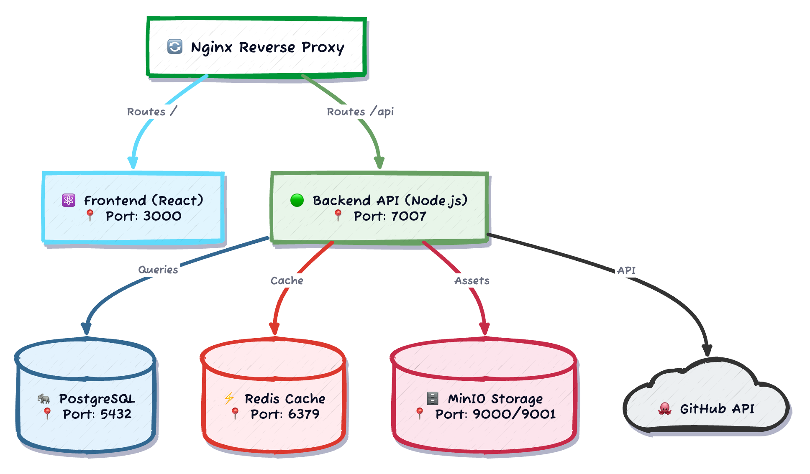

# Cloud Sandbox - Backstage Developer Portal

A fully-featured [Backstage](https://backstage.io) developer portal configured for cloud-native development teams. This portal provides a centralized hub for software catalog management, documentation, scaffolding, and team collaboration.

## Features

### Core Capabilities

- **Software Catalog** - Centralized registry of all software components, APIs, resources, and systems
- **TechDocs** - Built-in technical documentation with MkDocs and D2 diagram support
- **Software Templates** - Scaffolder templates for creating new projects, infrastructure, and resources
- **Search** - Full-text search across catalog entities, documentation, and more

### Custom Plugins

- **Branding Settings** - The portal ships with no organisation's name, logo or colours. An administrator sets the name, uploads a logo and picks a theme preset or primary colour at `/admin/branding`; the sidebar, sign-in page and documentation follow at once
- **Ownership Management** - Orphan detection and ownership reassignment for catalog entities
- **GitHub Team Sync** - Bi-directional synchronization between Backstage groups and GitHub teams

### Integrations

- **GitHub** - OAuth authentication, organization/team sync, repository scaffolding
- **Kubernetes** - Cluster visualization and management
- **MinIO/S3** - TechDocs storage and asset management
- **PostgreSQL** - Persistent data storage
- **Redis** - Caching for improved performance

### Templates

50+ scaffolder templates for:

- Cloud infrastructure (AWS, Azure, GCP)
- Application development (Node.js, Python, React, Spring Boot)
- DevOps automation (Terraform, Ansible, Docker, Kubernetes)
- Data engineering (Airflow, dbt, Superset)
- Documentation (ADRs, Runbooks, D2 diagrams)

Every template is held to the same rule: a repository created from it has a
pipeline, and that pipeline passes on its first push with nothing configured
by hand. Jobs that need a cloud account or another outside service are
skipped until their credentials are set. When adding or changing a template:

- Keep a `sample-values.json` next to its `template.yaml`: form values a user
  could enter. `yarn workspace @internal/edge template:check` renders every
  template with them through the real scaffolder, without publishing; add
  `--out <dir>` to keep what was rendered. The `Template check` workflow runs
  it on every change.
- The new repository's `catalog-info.yaml` names its own repository in
  `github.com/project-slug`, so the portal's CI/CD tab shows its runs, and
  carries `backstage.io/techdocs-ref: dir:.` with an `mkdocs.yml` and
  `docs/index.md`, so it has a documentation page.
- Push the rendered output to a scratch repository once and watch its
  workflows before registering the template in `app-config.yaml`.

## Quick Start

### Prerequisites

- Docker and Docker Compose
- **For Devbox (Recommended):** [Devbox](https://www.jetify.com/devbox/) (automatically installs Node.js, Yarn, Python, D2, etc.)
- **For Manual Setup:** Node.js 24 (22 supported), Yarn 4.13.0 (bundled)

### Development Modes

This project supports two development modes:

| Mode                         | Best For                 | Hot Reload            | Setup Complexity |
| ---------------------------- | ------------------------ | --------------------- | ---------------- |
| **Devbox + Docker Services** | Daily development        | Yes                   | Low              |
| **Full Docker Stack**        | Testing production setup | No (rebuild required) | Very Low         |

---

## Option 1: Devbox Development (Recommended)

Devbox provides a reproducible development environment with all tools pre-configured.

### Install Devbox

```bash
# Install Devbox (one-time setup)
curl -fsSL https://get.jetify.com/devbox | bash

# Devbox will automatically install Nix on first use
```

### Start Development

```bash
# Clone the repository
git clone <repository-url>
cd backstage

# Enter Devbox shell (installs Node.js 24, Yarn 4, Python, D2, etc.)
devbox shell

# Start Docker services (PostgreSQL, Redis, MinIO)
devbox run services:start

# Copy environment template
cp .env.example .env
# Edit .env with your configuration (especially GITHUB_* variables)

# Install dependencies
yarn install

# Start Backstage in development mode with hot reload
devbox run dev
```

Access the portal at http://localhost:3000 (frontend) and http://localhost:7007 (backend API).

### Devbox Commands

```bash
devbox run services:start    # Start Docker services (Postgres, Redis, MinIO)
devbox run services:stop     # Stop Docker services
devbox run services:status   # Check service status
devbox run dev               # Start Backstage with hot reload
devbox run build             # Build the backend
devbox run test              # Run tests
devbox run lint              # Run linter
devbox run techdocs          # Generate TechDocs
devbox run clean             # Clean build artifacts
devbox run reset             # Reset entire dev environment
```

---

## Option 2: Full Docker Stack

Run everything in Docker containers (closest to production).

### Start Full Stack

```bash
# Clone the repository
git clone <repository-url>
cd backstage

# Copy environment template
cp .env.example .env
# Edit .env with your configuration

# Start all services (PostgreSQL, Redis, MinIO, Backstage, Nginx)
docker compose up -d --wait

# View logs
docker compose logs -f backstage

# Access the portal
open http://localhost
```

### Full Docker Commands

```bash
# Start full stack
docker compose up -d --wait

# Stop full stack
docker compose down

# Rebuild after code changes
docker compose up -d --wait --build backstage

# View logs
docker compose logs -f

# Check status
docker compose ps
```

---

## Option 3: Makefile Shortcuts

The Makefile provides convenient shortcuts for common operations:

```bash
make help              # Show all available commands
make up                # Start full Docker stack (waits until healthy)
make down              # Stop full Docker stack
make dev               # Start containerised hot-reload dev stack
make infra-up          # Start infrastructure services only
make build             # Build Docker image
make logs              # Tail logs
make status            # Show container status
make devbox            # Enter Devbox shell
make devbox-services   # Start services for Devbox mode
```

---

## Configuration

### Environment Variables

Copy `.env.example` to `.env` and configure:

| Variable               | Description                          | Required       |
| ---------------------- | ------------------------------------ | -------------- |
| `GITHUB_TOKEN`         | Personal access token for GitHub API | Yes            |
| `GITHUB_CLIENT_ID`     | OAuth App client ID                  | Yes (for auth) |
| `GITHUB_CLIENT_SECRET` | OAuth App client secret              | Yes (for auth) |
| `GITHUB_ORG`           | GitHub organization for team sync    | Optional       |
| `POSTGRES_*`           | Database connection settings         | Yes            |
| `REDIS_*`              | Cache connection settings            | Yes            |
| `MINIO_*`              | Object storage settings              | Yes            |

See `.env.example` for the complete list with descriptions.

### Configuration Files

| File                         | Purpose                       |
| ---------------------------- | ----------------------------- |
| `app-config.yaml`            | Development configuration     |
| `app-config.production.yaml` | Production overrides          |
| `app-config.local.yaml`      | Local overrides (git-ignored) |

## Development

### Available Scripts

```bash
# Start development server (frontend + backend)
yarn start

# Build production backend
yarn build:backend

# Run TypeScript compiler
yarn tsc

# Run all tests
yarn test

# Run linting
yarn lint:all

# Format code
yarn prettier:check
```

### Project Structure

```
backstage/
├── packages/
│   ├── app/                 # Frontend application
│   │   └── src/
│   │       ├── components/  # React components
│   │       └── hooks/       # Custom React hooks
│   └── backend/             # Backend application
│       └── src/
│           ├── branding/    # Branding settings plugin
│           ├── index.ts     # Backend entry point
│           ├── permissionPolicy.ts
│           ├── ownershipManagementPlugin.ts
│           └── githubTeamSyncPlugin.ts
├── catalog/                 # Software catalog entities
├── templates/               # Scaffolder templates
├── docker/                  # Docker configuration
├── .github/workflows/       # CI/CD workflows
└── app-config.yaml          # Backstage configuration
```

## Docker Deployment

### Production Build

```bash
# Build the production Docker image
docker build -t backstage:latest .

# Run with environment variables
docker run -p 7007:7007 \
  -e POSTGRES_HOST=postgres \
  -e GITHUB_TOKEN=your-token \
  backstage:latest
```

### Docker Compose

The repository includes several compose files:

| File                           | Purpose                                                                     |
| ------------------------------ | --------------------------------------------------------------------------- |
| `docker-compose.yaml`          | Full stack: nginx + Backstage; includes `docker-compose.services.yaml`      |
| `docker-compose.services.yaml` | Infrastructure only (PostgreSQL 18, Redis 8, MinIO + bucket init); Devbox   |
| `docker-compose.dev.yaml`      | Override: hot-reload `yarn start` from the bind-mounted source (`make dev`) |
| `docker-compose.prod.yaml`     | Override: restart policies, resource limits, only nginx published           |

The stack runs on Docker Engine and on Apple `container` through the
[socktainer](https://github.com/socktainer/socktainer) Docker context. Image builds
use a dedicated BuildKit builder with 8 GB of memory (Apple `container` gives each
container 1 GB by default, which stalls `yarn install`): the `make` targets create
and select it automatically. For plain `docker compose build`, run `make builder` once
and `export BUILDX_BUILDER=backstage-builder`. If a build fails with
`structure needs cleaning`, the builder's state volume is corrupt: run
`make builder-reset` and build again.

## Cloudflare Workers Deployment

`edge/` runs the portal on Cloudflare without Docker or a server: a Worker serves
the built front end and answers the Backstage REST calls it makes from a D1
database and an R2 bucket. The Backstage Node backend cannot run on Workers (it
needs about 850 MB of memory against a 128 MB limit), so the work that needs it
runs in GitHub Actions, on a real Backstage backend, and the results are pushed
to the Worker:

| In the portal                                                   | Where the work happens                                 |
| --------------------------------------------------------------- | ------------------------------------------------------ |
| Catalog browsing, entity pages, relations graph, API explorer   | `portal-sync` processes the catalog, the Worker reads  |
| TechDocs pages                                                  | `portal-sync` builds them with mkdocs, R2 stores them  |
| Search over catalog entities and documentation                  | `portal-sync` builds the index, the Worker searches it |
| Creating from templates                                         | `portal-scaffold` runs the template steps              |
| CI/CD tab (GitHub Actions runs of a component)                  | The Worker reads them from GitHub                      |
| GitHub and Google sign-in, user settings (stars, theme)         | The Worker                                             |
| Branding (`/admin/branding`) and ownership (`/admin/ownership`) | The Worker; settings, logos and admins are kept in D1  |

The first person to sign in becomes the portal administrator, unless
`PORTAL_ADMINS` names the administrators. More can be added at
`/admin/branding`.

Not available yet: live notifications, catalog import and the template
editor.

### The pipelines

Both workflows start the **pipeline backend**
(`packages/backend/src/pipeline.ts`, configured by `app-config.pipeline.yaml`):
a Backstage backend with only the catalog, the scaffolder and its action
modules. It reads the catalog rules and locations from `app-config.yaml`, so it
processes the same entity files as the main backend. The scripts that drive it
are in `edge/scripts/pipeline`, and they write to the portal only through the
Worker's token-protected `/api/pipeline` endpoints.

For the deployed portal those endpoints are not called over the internet:
Cloudflare answers a GitHub Actions runner at the portal's public address with
a challenge page. The scripts start the same Worker on the runner with
`wrangler dev` (`edge/wrangler.pipeline.jsonc`), with its database and bucket
bindings marked `remote`, so the code runs on the runner and the data is the
deployed data, reached through Cloudflare's API. The token that local Worker
accepts is made for each run.

The repository is public, so the workflows are closed to it: none starts on a
pull request, an issue or a comment, and every job checks that the run was
started by the repository owner. Keep both when adding a workflow. In the
repository settings, Actions > General > "Approval for running fork pull
request workflows" is set to require approval for all external contributors.

**`portal-sync.yml`** runs on a push to the default branch that changes the
catalog, the templates or the pipeline itself, and on demand. It

1. processes every catalog location, plus the locations of repositories created
   from templates, and waits until the catalog has settled;
2. builds the documentation of every entity with a `backstage.io/techdocs-ref`
   annotation, each distinct docs directory once, cloning other repositories
   as needed;
3. uploads the documentation files that changed and replaces the catalog, the
   search index and the entity-to-documentation mapping in one commit, so the
   portal never shows half a catalog;
4. writes the counts to the job summary.

The sync fails, and leaves the portal as it was, when an entity file of this
repository does not process. A documentation site that does not build is
reported and skipped, and keeps serving its last good build.

**`portal-scaffold.yml`** is started by the Worker when a user creates
something from a template. It runs the template in the real scaffolder, sends
every log line and the result back to the portal as they happen, hands the
catalog file of the new repository to the portal, and then runs the sync so
the new component and its documentation appear.

**`template-check.yml`** renders every template with its sample values when a
template or the pipeline changes.

Set these in the GitHub repository (Settings > Secrets and variables > Actions):

| Name                    | Kind   | Value                                                                                                                                 |
| ----------------------- | ------ | ------------------------------------------------------------------------------------------------------------------------------------- |
| `CLOUDFLARE_API_TOKEN`  | Secret | A Cloudflare API token for the portal's account with Edit on D1, Workers R2 Storage and Workers Scripts                               |
| `CLOUDFLARE_ACCOUNT_ID` | Secret | The id of that account (not confidential; a secret so that logs mask it)                                                              |
| `PORTAL_GITHUB_TOKEN`   | Secret | A GitHub token that can read this repository, and create repositories and push workflow files for the owners the templates publish to |

Each workflow stops at its first step with a clear message when one is missing.

### Deploying

```bash
# One-time: create the database and the documentation bucket, and put the
# database id in edge/wrangler.jsonc
yarn workspace @internal/edge wrangler d1 create cloud-sandbox
yarn workspace @internal/edge wrangler r2 bucket create cloud-sandbox-techdocs

# One-time: list who may sign in and the OAuth client IDs
cp edge/.prod.vars.example edge/.prod.vars

# Each release: build the app, migrate, deploy
yarn workspace app build --config ../../app-config.yaml
yarn workspace @internal/edge db:migrate:remote
yarn workspace @internal/edge deploy

# Then fill it: run the "Portal sync" workflow, in GitHub or with
gh workflow run portal-sync.yml
```

The Worker is served only on the custom domain set under `routes` in
`edge/wrangler.jsonc`; the workers.dev address is turned off. That file holds
only what is safe to publish: the domain, the database id, and the repository
and branch whose workflows the portal starts (`PORTAL_REPO`, `PORTAL_REF`).
Guest sign-in is off in the deployment and on for local development
(`.dev.vars`).

Everything else is stored in Cloudflare and never committed. `edge/.prod.vars`
(ignored by Git) lists the GitHub and Google client IDs and who may sign in
(`GITHUB_CLIENT_ID`, `GITHUB_ALLOWED_USERS`, `GOOGLE_CLIENT_ID`,
`GOOGLE_ALLOWED_EMAILS`, `GOOGLE_ALLOWED_DOMAINS`); the deploy uploads them.
Nobody outside those lists can sign in. Everyone who does sign in becomes a
User in the catalog (name, picture and email from the provider), kept in the
`signed_in_users` table so that a catalog sync does not remove them; a user
the catalog files also define keeps the files' definition. Run
`db:migrate:remote` before pushing a change that adds a migration: the
pipelines run the Worker from the checkout against the deployed database.

Five more values are set once with `wrangler secret put <NAME>`:
`SESSION_SECRET` (signs user tokens and session cookies), `GITHUB_CLIENT_SECRET`,
`GOOGLE_CLIENT_SECRET`, `PIPELINE_TOKEN` (guards `/api/pipeline` on the public
address, which nothing needs to call: generate it with `openssl rand -hex 32`
and keep no copy) and `PORTAL_GITHUB_TOKEN` (starts the `portal-scaffold`
workflow and reads workflow runs for the CI/CD tab).
`node scripts/create-github-app.mjs <portal URL>` creates the GitHub App and
stores its secret; the Google client is created in the Google Cloud console
with the redirect URI `<portal URL>/api/auth/google/handler/frame`.

### Local development

The sync builds documentation with the TechDocs toolchain, so `mkdocs` and `d2`
must be on the `PATH`, in the versions the root `Dockerfile` pins:

```bash
python3 -m venv .venv-techdocs && . .venv-techdocs/bin/activate
pip install $(node edge/scripts/pipeline/toolchain.mjs pip)
# D2: https://d2lang.com/tour/install, version:
node edge/scripts/pipeline/toolchain.mjs d2
```

```bash
# The Worker on http://localhost:8787 (copy edge/.dev.vars.example first)
yarn workspace @internal/edge db:migrate:local
yarn workspace @internal/edge dev

# In another terminal: fill it from this checkout. The token is read from
# edge/.dev.vars.
PORTAL_URL=http://localhost:8787 yarn workspace @internal/edge catalog:sync

# Check that the Worker answers catalog requests exactly like the backend
yarn workspace @internal/edge verify
```

To update the deployed portal from your machine instead, leave `PORTAL_URL`
unset and set `CLOUDFLARE_API_TOKEN` (and `CLOUDFLARE_ACCOUNT_ID`), as the
workflows do. `PORTAL_URL` wins when both are set.

`catalog:sync` reads the entity files from the checkout; in GitHub Actions it
reads them from the repository on GitHub instead, so that entities link to
their source. It keeps the pipeline backend's SQLite files in
`edge/.wrangler/pipeline` (`PIPELINE_DATA_DIR`). `verify` starts that backend
again on those files, sends the same catalog requests to it and to the Worker,
and reports any difference in the answers. It signs in to the Worker as a
guest, so point `EDGE_URL` at a local `yarn dev` Worker.

A template run can be tried the same way, with
`yarn workspace @internal/edge template:run` and the variables listed at the
top of `edge/scripts/pipeline/run-template.mjs`. To start the pipeline backend
by hand, see the top of `app-config.pipeline.yaml`.

## Troubleshooting

### Devbox Issues

**"Nix not installed" error:**

```bash
# Devbox will prompt to install Nix automatically, or install manually:
curl --proto '=https' --tlsv1.2 -sSf -L https://install.determinate.systems/nix | sh -s -- install
```

**Package installation fails:**

```bash
# Clear Devbox cache and retry
devbox rm --all
devbox install
```

### Docker Issues

**Port already in use:**

```bash
# Check what's using the port
lsof -i :7007
lsof -i :5432

# Stop conflicting services or change ports in docker-compose
```

**Container won't start:**

```bash
# Check logs for the specific container
docker compose logs backstage

# Rebuild from scratch
docker compose down -v
docker compose up -d --wait --build
```

### Database Issues

**Reset database:**

```bash
# Stop services and remove volumes
docker compose down -v

# Or in Devbox mode:
devbox run reset
```

## Architecture



### Key Components

- **Frontend (React)** - User interface built with Material-UI
- **Backend (Node.js)** - API server with plugin architecture
- **PostgreSQL** - Persistent storage for catalog, auth, and plugin data
- **Redis** - Caching layer for improved performance
- **MinIO** - S3-compatible storage for TechDocs and assets
- **Nginx** - Reverse proxy for routing and SSL termination

## Security

### Authentication

The portal supports multiple authentication providers:

- **GitHub OAuth** - Primary authentication for production
- **Guest Access** - Optional read-only access (disabled by default in production)

### Authorization

Role-based access control via group membership:

| Role   | Groups                      | Permissions            |
| ------ | --------------------------- | ---------------------- |
| Admin  | `admins`, `platform-admins` | Full access            |
| Editor | `editors`, `developers`     | Create/modify entities |
| Viewer | All authenticated users     | Read-only access       |

### Security Best Practices

- CORS is restricted to specific origins in production
- Guest auth is disabled by default in production
- All secrets are managed via environment variables
- TLS termination at the reverse proxy

## Contributing

See [CONTRIBUTING.md](CONTRIBUTING.md) for contribution guidelines.

## Documentation

- [Complete Setup Guide](SETUP.md) - Detailed installation and configuration
- [Architecture Overview](ARCHITECTURE.md) - System design and components
- [Contributing Guidelines](CONTRIBUTING.md) - How to contribute
- [Backstage Documentation](https://backstage.io/docs) - Official Backstage docs
- [Template Development Guide](templates/README.md) - Creating custom templates

## License

This project is based on [Backstage](https://backstage.io) by Spotify.
